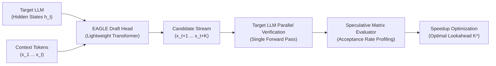
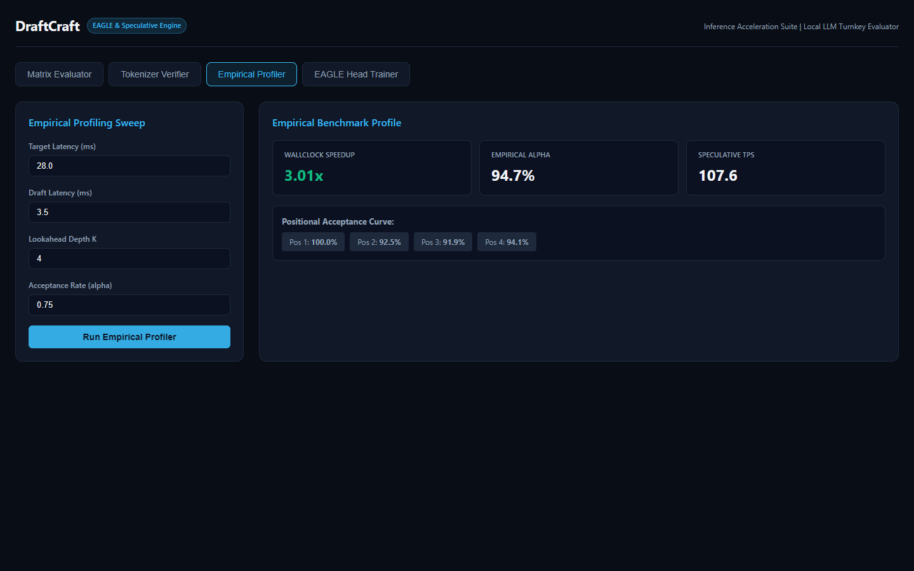
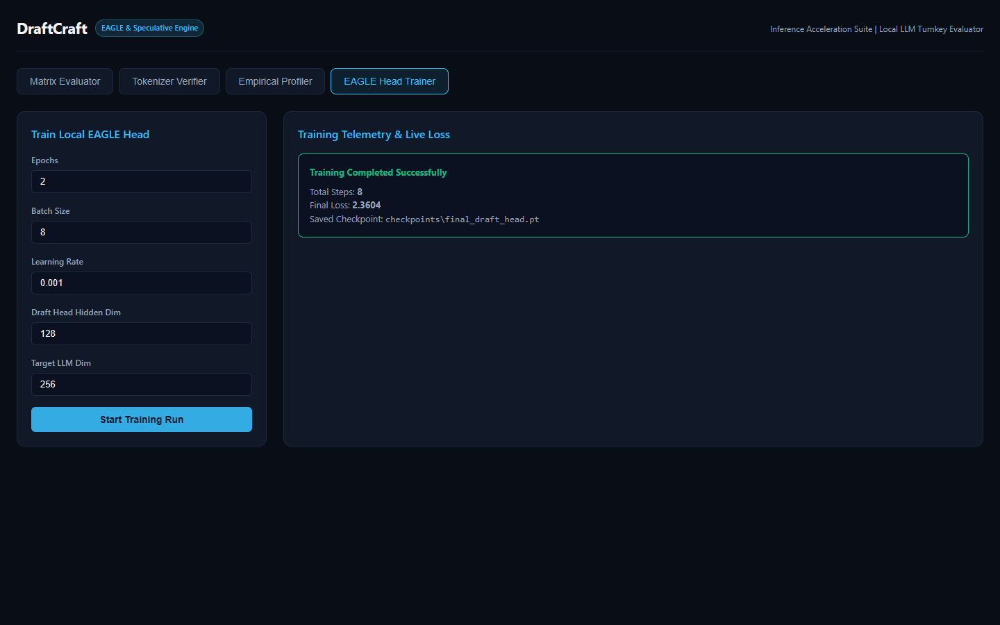

<div align="center">

# DraftCraft

**Turnkey Speculative Decoding Matrix Evaluator and EAGLE Draft Head Trainer for Local LLMs**

[](https://python.org)
[](https://pytorch.org)
[](https://fastapi.tiangolo.com)
[](LICENSE)
[]()

<br />


</div>

## Overview

DraftCraft evaluates speculative decoding feasibility and trains lightweight EAGLE draft heads for local large language models. Speculative decoding pairs a target LLM with a fast draft model or specialized draft head. The draft model proposes $K$ tokens in sequence, which the target model verifies in a single forward pass.

The realized acceleration depends on two factors: the token acceptance rate $\alpha$ and the latency ratio $c = t_{\text{draft}} / t_{\text{target}}$. DraftCraft profiles these dynamics across different prompt domains, checks tokenizer compatibility, calculates the optimal lookahead depth $K^*$, and provides a complete PyTorch training pipeline for single and multi-layer EAGLE draft heads on consumer GPUs.

## Key Features

- **Mathematical Matrix Evaluator**: Calculates theoretical and empirical speedup factors across lookahead depths $K \in [1, 16]$, latency ratios, and tree speculation branching factors $W$. Flags Pareto optimal configurations.
- **Tokenizer Alignment Verifier**: Detects vocabulary mismatches, token-to-ID drift, special token inconsistencies, and subword boundary segmentation divergence before running inference.
- **Authentic PyTorch EAGLE Draft Head**: Implements a transformer decoder draft head with RMSNorm, Multi-Head Attention, and SwiGLU MLP layers that conditions on target hidden states and token embeddings.
- **Distillation Training Pipeline**: Trains draft heads using a joint loss combining hidden state regression (MSE) and next-token prediction (Cross-Entropy) with AdamW and Cosine Annealing.
- **Rich Terminal CLI**: Provides interactive terminal commands with formatted tables, progress bars, and hardware diagnostics via Typer and Rich.
- **Web Dashboard**: Delivers a standalone dark-theme web interface with interactive sliders, matrix tables, tokenizer inspection, and live training telemetry via FastAPI.

---

## Architectural Workflow



---

## Speculative Decoding Formulations

### 1. Acceptance Rate $\alpha$

For target probability distribution $p(x)$ and draft distribution $q(x)$ over vocabulary $\mathcal{V}$, the exact token acceptance probability equals the distribution intersection, which relates directly to Total Variation (TV) distance:

$$\alpha = \sum_{x \in \mathcal{V}} \min(p(x), q(x)) = 1 - \frac{1}{2} \|p - q\|_1 = 1 - \text{TV}(p, q)$$

During generation, each draft token is accepted with probability $\min(1, p(x) / q(x))$. When a draft token is rejected, the target model resamples a token from the normalized residual distribution:

$$p'(x) = \frac{\max(0, p(x) - q(x))}{\sum_{y} \max(0, p(y) - q(y))}$$

This guarantees that the sampled output distribution matches the target LLM distribution exactly.

### 2. Expected Accepted Tokens per Step

For a linear speculative chain of length $K$ with homogeneous acceptance probability $\alpha$:

$$\mathbb{E}[\tau] = \sum_{j=0}^{K-1} (j+1) \alpha^j (1 - \alpha) + (K + 1)\alpha^K = \frac{1 - \alpha^{K+1}}{1 - \alpha}$$

When token acceptance degrades across consecutive positions $(\alpha_1, \alpha_2, \dots, \alpha_K)$, the expectation becomes:

$$\mathbb{E}[\tau] = 1 + \sum_{i=1}^K \prod_{j=1}^i \alpha_j$$

### 3. Theoretical Speedup

Let $t_{\text{draft}}$ be the execution time for one draft proposal step, $t_{\text{target}}$ the verification pass time for the target model, and $t_{\text{overhead}}$ the verification overhead. The speedup ratio relative to standard auto-regressive generation is:

$$\text{Speedup} = \frac{\mathbb{E}[\tau] \cdot t_{\text{target}}}{K \cdot t_{\text{draft}} + t_{\text{target}} + t_{\text{overhead}}} = \frac{\mathbb{E}[\tau]}{1 + c \cdot K + \epsilon}$$

where $c = t_{\text{draft}} / t_{\text{target}}$ represents the latency ratio.

---

## Installation

```bash
git clone https://github.com/alexandrmotologa/draftcraft.git
cd draftcraft

# Create virtual environment
python -m venv .venv
source .venv/bin/activate  # On Windows: .venv\Scripts\activate

# Install package and dependencies
pip install -e .
```

---

## Command Line Interface

DraftCraft provides a CLI powered by Typer and Rich.

### System Diagnostics

```bash
draftcraft info
```

Displays installed versions, hardware acceleration status (CUDA or CPU), and active PyTorch compute threads.

### Tokenizer Alignment Verification

```bash
# Verify alignment for an EAGLE draft head
draftcraft check-tokenizer --target-size 128256 --draft-size 128256

# Verify alignment between two separate model checkpoints
draftcraft check-tokenizer --target-size 128256 --draft-size 32000 --separate-llm
```

### Empirical Profiling

```bash
draftcraft profile --alpha 0.78 --depth 4 --draft-latency 3.5 --target-latency 28.0 --domain code
```

Runs a simulated verification cycle across prompt streams, reporting empirical acceptance degradation per position and speculative throughput in tokens per second.

### Speculative Decoding Matrix

```bash
draftcraft matrix --min-depth 1 --max-depth 8 --draft-latency 3.2 --target-latency 27.5
```

Evaluates every combination of lookahead depth and tree branching width, highlighting Pareto optimal points and the configuration that delivers maximum speedup.

### EAGLE Draft Head Training

```bash
draftcraft train --epochs 3 --batch-size 8 --hidden-dim 256 --target-dim 512 --vocab-size 2000 --out-dir checkpoints
```

Trains a draft head using feature distillation loss and writes the state dictionary and metadata to disk.

### Web Dashboard

```bash
draftcraft serve --host 127.0.0.1 --port 8000
```

Starts the FastAPI server and launches the dark-theme web dashboard at `http://127.0.0.1:8000`.

---

## Visual Studio Dashboard

<div align="center">
  
  <p><em>Speculative Decoding Matrix and Pareto Optimal Explorer</em></p>
  <br />
  
  <p><em>Tokenizer Parity and Special Token Alignment Inspector</em></p>
  <br />
  
  <p><em>Positional Acceptance Degradation Curve and Throughput Meter</em></p>
  <br />
  
  <p><em>EAGLE Draft Head Distillation Training Studio</em></p>
</div>

---

## Python API Usage

```python
import torch
from draftcraft.models.draft_head import EagleDraftHead
from draftcraft.core.config import EagleDraftHeadConfig
from draftcraft.profiler.acceptance_math import AcceptanceMath

# 1. Instantiate an EAGLE Draft Head
config = EagleDraftHeadConfig(
    hidden_dim=1024,
    target_hidden_dim=4096,
    num_layers=2,
    num_heads=8,
    intermediate_dim=2048,
    vocab_size=128256,
)
draft_head = EagleDraftHead(config)

# 2. Propose candidate tokens autoregressively
initial_hidden = torch.randn(1, 1, 4096)
candidates, pred_hidden = draft_head.generate_draft_candidates(
    initial_hidden_state=initial_hidden,
    initial_token_id=128000,
    lookahead_k=4,
)
print("Candidate token IDs:", candidates)

# 3. Calculate speedup factor
optimal_k, peak_speedup = AcceptanceMath.find_optimal_lookahead(
    alpha=0.76,
    draft_latency_ms=3.2,
    target_latency_ms=28.0,
)
print(f"Optimal lookahead K* = {optimal_k}, Peak Speedup = {peak_speedup:.2f}x")
```

---

## Testing

DraftCraft includes unit and integration tests covering mathematical formulations, neural forward passes, training loops, CLI commands, and REST endpoints.

Run the test suite with pytest:

```bash
pytest -v
```

All 40 test cases execute in approximately 5 seconds on CPU.

---

## Project Structure

```
draftcraft/
├── src/draftcraft/
│   ├── core/
│   │   ├── config.py           # Pydantic configuration schemas and validation
│   │   ├── types.py            # Domain types, Enums, and data models
│   │   └── exceptions.py       # Custom exception hierarchy
│   ├── alignment/
│   │   ├── tokenizer_verifier.py # Tokenizer parity and special token checks
│   │   ├── vocab_mapper.py     # Vocabulary ID mapping and collision analysis
│   │   └── corpus_sampler.py   # Multi-domain benchmark evaluation prompts
│   ├── profiler/
│   │   ├── acceptance_math.py  # Exact acceptance and speedup formulations
│   │   ├── speculative_profiler.py # Empirical verification simulation
│   │   └── matrix_evaluator.py # Multi-parameter grid and Pareto optimizer
│   ├── models/
│   │   ├── draft_head.py       # PyTorch EAGLE draft head architecture
│   │   ├── tree_attention.py   # 2D tree attention mask builder
│   │   └── loss.py             # Feature distillation and token classification loss
│   ├── trainer/
│   │   ├── dataset.py          # Sequence dataset and synthetic generator
│   │   ├── checkpoint.py       # State dict and metadata serialization
│   │   └── eagle_trainer.py    # Training loop with Cosine Annealing and logging
│   ├── cli/
│   │   ├── main.py             # Typer application entry point
│   │   └── commands.py         # Terminal commands with Rich rendering
│   └── web/
│       ├── app.py              # FastAPI app and dashboard HTML
│       └── routes.py           # REST endpoints
├── tests/
│   ├── test_config.py
│   ├── test_tokenizer_verifier.py
│   ├── test_acceptance_math.py
│   ├── test_speculative_profiler.py
│   ├── test_draft_head.py
│   ├── test_trainer.py
│   ├── test_cli.py
│   └── test_web.py
├── docs/
│   └── images/                 # UI screenshots and animated demo GIF
├── pyproject.toml
└── README.md
```

---

## License

This project is licensed under the MIT License. See [LICENSE](LICENSE) for details.
