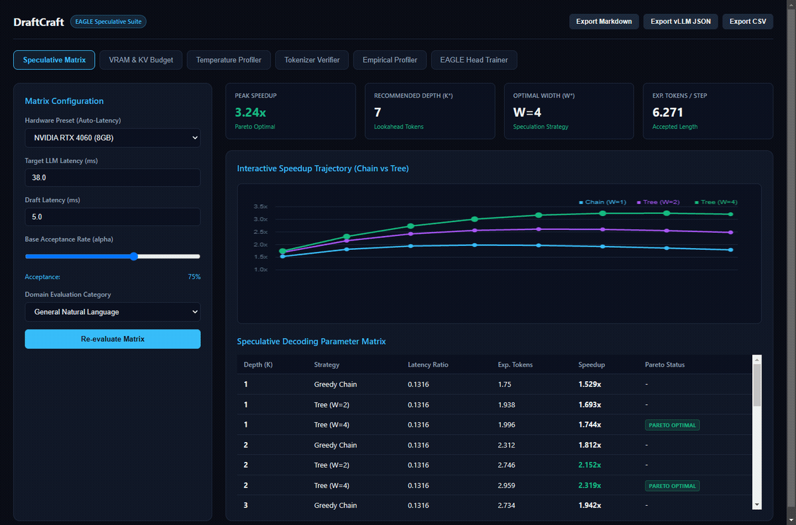
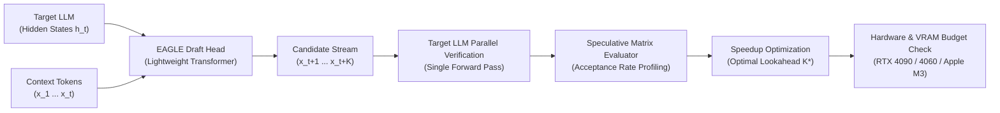
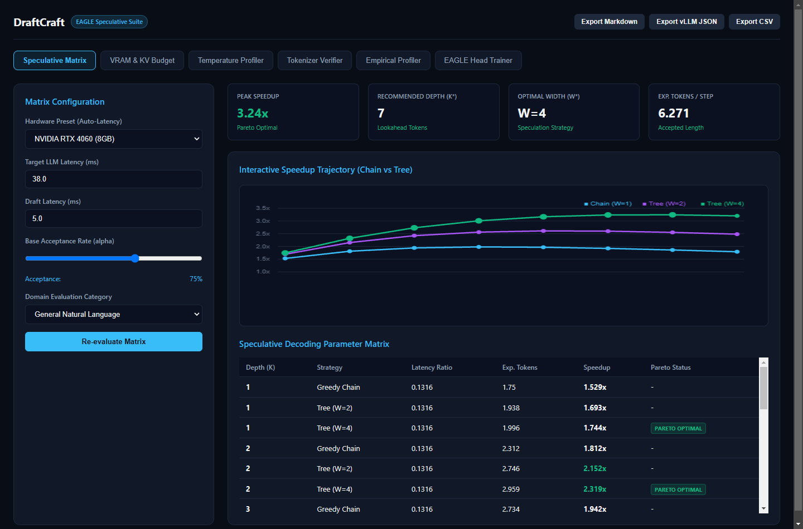
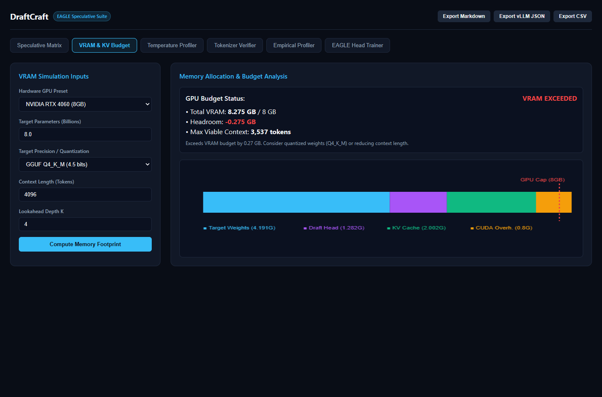
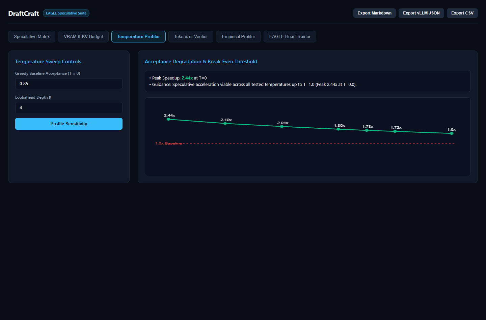
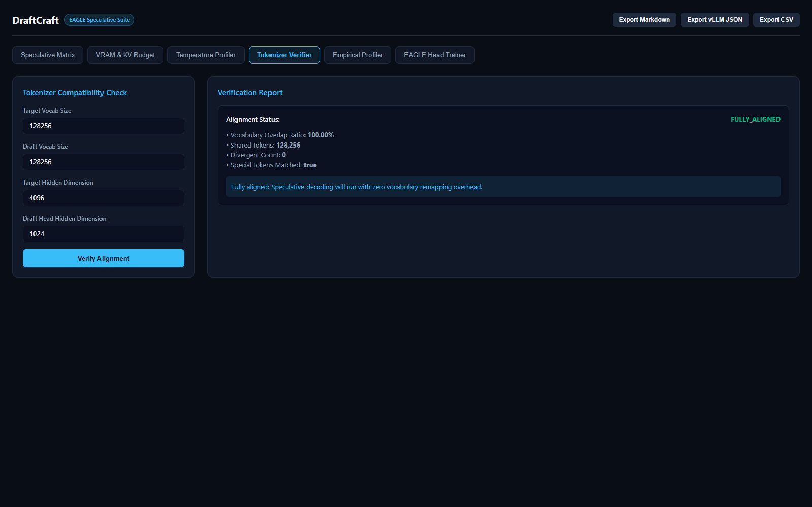

<div align="center">

# DraftCraft

**Turnkey Speculative Decoding Matrix Evaluator and EAGLE Draft Head Trainer for Local LLMs**

[](https://python.org)
[](https://pytorch.org)
[](https://fastapi.tiangolo.com)
[](LICENSE)
[]()

<br />



</div>

## Overview

DraftCraft evaluates speculative decoding feasibility and trains lightweight EAGLE draft heads for local large language models. Speculative decoding pairs a target LLM with a fast draft model or specialized draft head. The draft model proposes $K$ tokens in sequence, which the target model verifies in a single forward pass.

The realized acceleration depends on the token acceptance rate $\alpha$, the latency ratio $c = t_{\text{draft}} / t_{\text{target}}$, and the available VRAM bandwidth. DraftCraft profiles these dynamics across different prompt domains, checks tokenizer compatibility, calculates the optimal lookahead depth $K^*$, verifies GPU memory budgets, and provides a PyTorch training pipeline for single and multi-layer EAGLE draft heads on consumer GPUs.

## Key Features

- **Mathematical Matrix Evaluator**: Calculates theoretical and empirical speedup factors across lookahead depths $K \in [1, 16]$, latency ratios, and tree speculation branching factors $W$. Identifies Pareto optimal points.
- **Hardware Presets & VRAM Budget Calculator**: Analyzes GPU memory allocation across base weights, EAGLE draft heads, and KV cache expansion buffers. Supports presets for NVIDIA RTX 4090, 4080, 4070 Ti, 4060, 3060, and Apple Silicon M3.
- **Temperature Sensitivity Profiling**: Evaluates acceptance degradation from greedy decoding ($T=0.0$) through high-entropy sampling ($T=1.0$) and identifies break-even viability thresholds.
- **Tokenizer JSON File Loader & Remapper**: Inspects real Hugging Face `tokenizer.json` files from disk, cross-references vocabularies, flags token ID drift, and exports remapping tables for inference runtimes.
- **Authentic PyTorch EAGLE Draft Head**: Implements a transformer decoder draft head with RMSNorm, Multi-Head Attention, and SwiGLU MLP layers conditioning on target hidden states and token embeddings.
- **Distillation Training Pipeline**: Trains draft heads using a joint loss combining hidden state regression (MSE) and next-token prediction (Cross-Entropy) with AdamW and Cosine Annealing.
- **Production Runtime Exporter**: Exports evaluation matrices and configurations to Markdown, CSV, JSON, and direct vLLM / SGLang speculative decoding formats.
- **Web Dashboard with Interactive Canvas Charts**: Features interactive multi-line speedup curves, stacked VRAM memory bars, positional acceptance decay histograms, and real-time training loss graphs.

---

## Architectural Workflow



---

## Speculative Decoding Formulations

### 1. Acceptance Rate $\alpha$

For target probability distribution $p(x)$ and draft distribution $q(x)$ over vocabulary $\mathcal{V}$, the token acceptance probability equals the distribution intersection, corresponding to Total Variation (TV) distance:

$$\alpha = \sum_{x \in \mathcal{V}} \min(p(x), q(x)) = 1 - \frac{1}{2} \|p - q\|_1 = 1 - \text{TV}(p, q)$$

Each draft token is accepted with probability $\min(1, p(x) / q(x))$. Upon rejection, the target model resamples a token from the normalized residual distribution:

$$p'(x) = \frac{\max(0, p(x) - q(x))}{\sum_{y} \max(0, p(y) - q(y))}$$

This ensures that the output distribution matches the target LLM distribution exactly.

### 2. Expected Accepted Tokens per Step

For a linear speculative chain of length $K$ with homogeneous acceptance probability $\alpha$:

$$\mathbb{E}[\tau] = \sum_{j=0}^{K-1} (j+1) \alpha^j (1 - \alpha) + (K + 1)\alpha^K = \frac{1 - \alpha^{K+1}}{1 - \alpha}$$

For positional acceptance rates $(\alpha_1, \alpha_2, \dots, \alpha_K)$ reflecting autoregressive error compounding:

$$\mathbb{E}[\tau] = 1 + \sum_{i=1}^K \prod_{j=1}^i \alpha_j$$

For tree speculative decoding with branching factor $W$ at depth $D$:

$$\mathbb{E}[\tau_{\text{tree}}] = 1 + \sum_{d=1}^D \left(1 - (1 - \alpha^d)^W\right)$$

### 3. Theoretical Speedup

$$\text{Speedup} = \frac{\mathbb{E}[\tau] \cdot t_{\text{target}}}{K \cdot t_{\text{draft}} + t_{\text{target}} + t_{\text{overhead}}} = \frac{\mathbb{E}[\tau]}{1 + c \cdot K + \epsilon}$$

where $c = t_{\text{draft}} / t_{\text{target}}$ represents the latency ratio.

---

## Installation

```bash
git clone https://github.com/alexandrmotologa/draftcraft.git
cd draftcraft

# Create virtual environment
python -m venv .venv
source .venv/bin/activate  # On Windows: .venv\Scripts\activate

# Install package and dependencies
pip install -e .
```

---

## Command Line Interface

DraftCraft provides a CLI powered by Typer and Rich.

### System Diagnostics

```bash
draftcraft info
```

Displays installed versions, hardware acceleration status (CUDA or CPU), and active PyTorch compute threads.

### VRAM & KV Cache Budget Analysis

```bash
# Analyze memory for an 8B Q4_K_M model on an RTX 4060 8GB
draftcraft vram --preset rtx-4060-8gb --params 8.0 --precision q4_k_m --context 4096

# Evaluate on a 24GB workstation GPU
draftcraft vram --preset rtx-4090 --params 8.0 --precision fp16 --context 8192
```

Outputs a component memory breakdown (weights, draft head, base KV cache, speculative KV buffer, CUDA overhead), remaining headroom, and maximum viable context length.

### Tokenizer Alignment Verification

```bash
# Verify alignment for an EAGLE draft head
draftcraft check-tokenizer --target-size 128256 --draft-size 128256

# Verify real Hugging Face tokenizer.json files from disk and export remapping
draftcraft check-tokenizer --target-file path/to/target_tokenizer.json --draft-file path/to/draft_tokenizer.json --export-remap remap.json
```

### Speculative Decoding Matrix

```bash
# Evaluate matrix using hardware presets
draftcraft matrix --preset rtx-4060-8gb --domain code --min-depth 1 --max-depth 8
```

Explores lookahead depths and tree widths, highlighting Pareto optimal configurations and the peak acceleration point.

### Temperature Sensitivity Profiling

```bash
draftcraft temp-profile --alpha 0.85 --depth 4 --preset rtx-4060-8gb
```

Profiles acceptance degradation across temperatures $T \in [0.0, 1.0]$ and identifies break-even thresholds.

### Production Runtime Export

```bash
# Export Markdown evaluation report
draftcraft export --output report.md --preset rtx-4090 --domain reasoning

# Export vLLM speculative configuration
draftcraft export --output vllm_config.json --preset rtx-4060-8gb
```

### EAGLE Draft Head Training

```bash
draftcraft train --epochs 3 --batch-size 8 --hidden-dim 256 --target-dim 512 --vocab-size 2000 --out-dir checkpoints
```

Trains a draft head using feature distillation loss and writes the state dictionary and metadata to disk.

### Web Dashboard

```bash
draftcraft serve --host 127.0.0.1 --port 8000
```

Starts the FastAPI server and launches the dark-theme web dashboard at `http://127.0.0.1:8000`.

---

## Visual Studio Dashboard

<div align="center">
  
  <p><em>Speculative Decoding Matrix and Interactive Speedup Trajectory Canvas</em></p>
  <br />
  
  <p><em>VRAM Memory Allocation and Stacked Memory Bandwidth Analyzer</em></p>
  <br />
  
  <p><em>Temperature Sensitivity Curve and Viability Threshold Meter</em></p>
  <br />
  
  <p><em>Tokenizer Parity and Special Token Alignment Inspector</em></p>
</div>

---

## Python API Usage

```python
import torch
from draftcraft.models.draft_head import EagleDraftHead
from draftcraft.core.config import EagleDraftHeadConfig
from draftcraft.profiler.acceptance_math import AcceptanceMath
from draftcraft.profiler.vram_calculator import VRAMCalculator, PrecisionType

# 1. Instantiate an EAGLE Draft Head
config = EagleDraftHeadConfig(
    hidden_dim=1024,
    target_hidden_dim=4096,
    num_layers=2,
    num_heads=8,
    intermediate_dim=2048,
    vocab_size=128256,
)
draft_head = EagleDraftHead(config)

# 2. Check GPU VRAM feasibility
vram = VRAMCalculator.calculate_memory(
    target_param_count_billions=8.0,
    target_precision=PrecisionType.Q4_K_M,
    context_len=4096,
    lookahead_k=4,
    gpu_capacity_gb=12.0,
)
print(f"Total VRAM required: {vram.total_vram_gb:.2f} GB (Fits: {vram.fits_in_gpu})")

# 3. Propose candidate tokens autoregressively
initial_hidden = torch.randn(1, 1, 4096)
candidates, pred_hidden = draft_head.generate_draft_candidates(
    initial_hidden_state=initial_hidden,
    initial_token_id=128000,
    lookahead_k=4,
)
print("Candidate token IDs:", candidates)
```

---

## Testing

DraftCraft includes unit and integration tests covering mathematical formulations, memory calculations, tokenizer file parsing, neural forward passes, training loops, CLI commands, and REST endpoints.

Run the test suite with pytest:

```bash
pytest -v
```

All 61 test cases execute in approximately 5 seconds on CPU.

---

## Project Structure

```
draftcraft/
├── src/draftcraft/
│   ├── core/
│   │   ├── config.py           # Pydantic configuration schemas and validation
│   │   ├── types.py            # Domain types, Enums, and data models
│   │   └── exceptions.py       # Custom exception hierarchy
│   ├── alignment/
│   │   ├── file_loader.py      # Hugging Face tokenizer.json file reader and remapper
│   │   ├── tokenizer_verifier.py # Tokenizer parity and special token checks
│   │   ├── vocab_mapper.py     # Vocabulary ID mapping and collision analysis
│   │   └── corpus_sampler.py   # Multi-domain benchmark evaluation prompts
│   ├── profiler/
│   │   ├── acceptance_math.py  # Exact acceptance and speedup formulations
│   │   ├── speculative_profiler.py # Empirical verification simulation
│   │   ├── matrix_evaluator.py # Multi-parameter grid and Pareto optimizer
│   │   ├── vram_calculator.py  # GPU memory budget and KV cache footprint calculator
│   │   ├── temperature_profiler.py # Temperature sensitivity and break-even evaluator
│   │   └── exporter.py         # Markdown, CSV, JSON, and vLLM config exporter
│   ├── models/
│   │   ├── draft_head.py       # PyTorch EAGLE draft head architecture
│   │   ├── tree_attention.py   # 2D tree attention mask builder
│   │   └── loss.py             # Feature distillation and token classification loss
│   ├── trainer/
│   │   ├── dataset.py          # Sequence dataset and synthetic generator
│   │   ├── checkpoint.py       # State dict and metadata serialization
│   │   └── eagle_trainer.py    # Training loop with Cosine Annealing and logging
│   ├── cli/
│   │   ├── main.py             # Typer application entry point
│   │   └── commands.py         # Terminal commands with Rich rendering
│   └── web/
│       ├── app.py              # FastAPI app and interactive Canvas dashboard
│       └── routes.py           # REST endpoints
├── tests/
│   ├── test_acceptance_math.py
│   ├── test_cli.py
│   ├── test_config.py
│   ├── test_draft_head.py
│   ├── test_exporter.py
│   ├── test_file_loader.py
│   ├── test_speculative_profiler.py
│   ├── test_temperature_profiler.py
│   ├── test_tokenizer_verifier.py
│   ├── test_trainer.py
│   ├── test_vram_calculator.py
│   └── test_web.py
├── docs/
│   └── images/                 # UI screenshots and animated demo GIF
├── pyproject.toml
└── README.md
```

---

## License

This project is licensed under the MIT License. See [LICENSE](LICENSE) for details.
